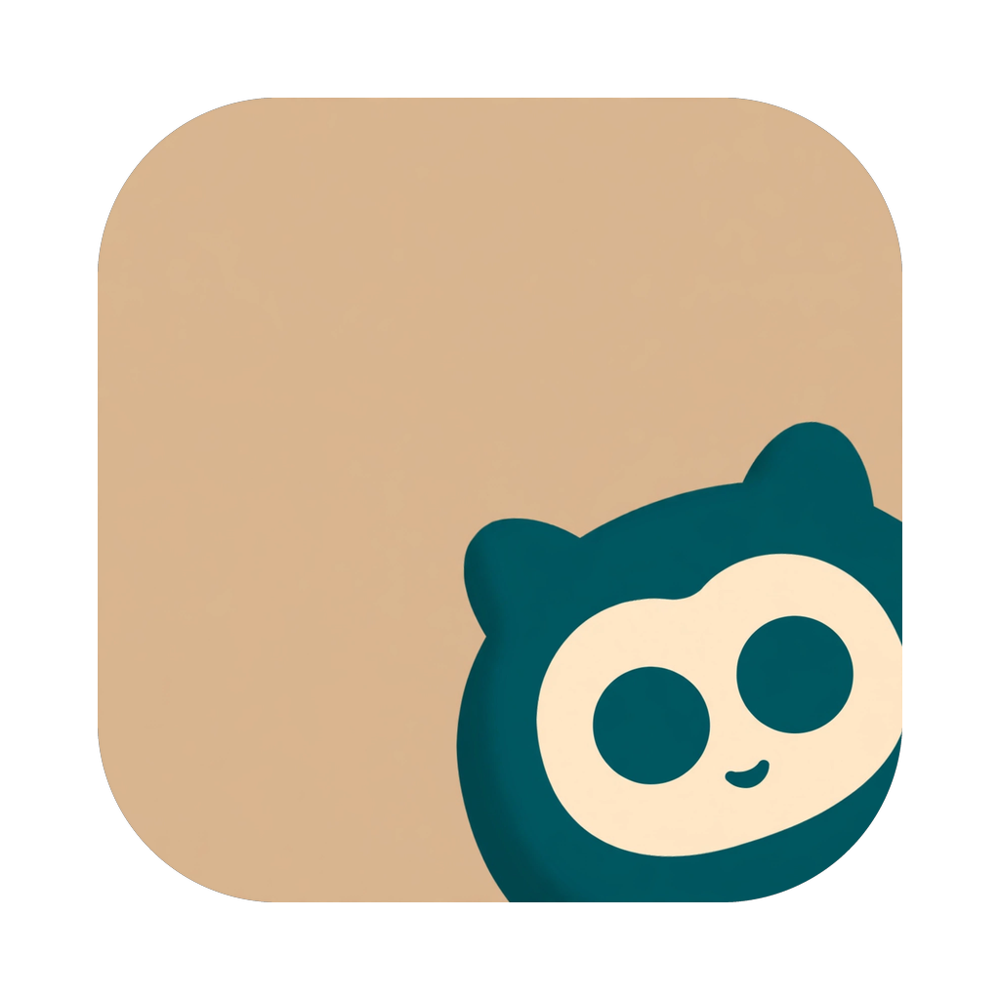
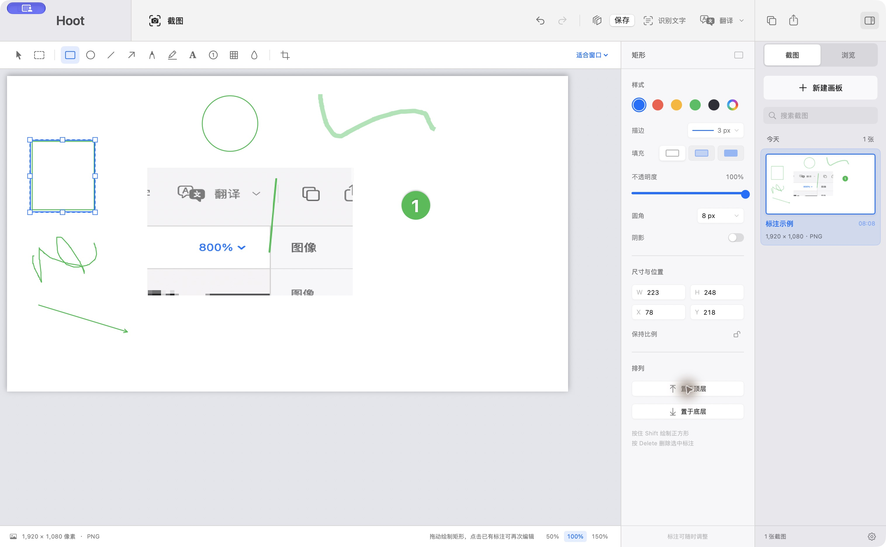
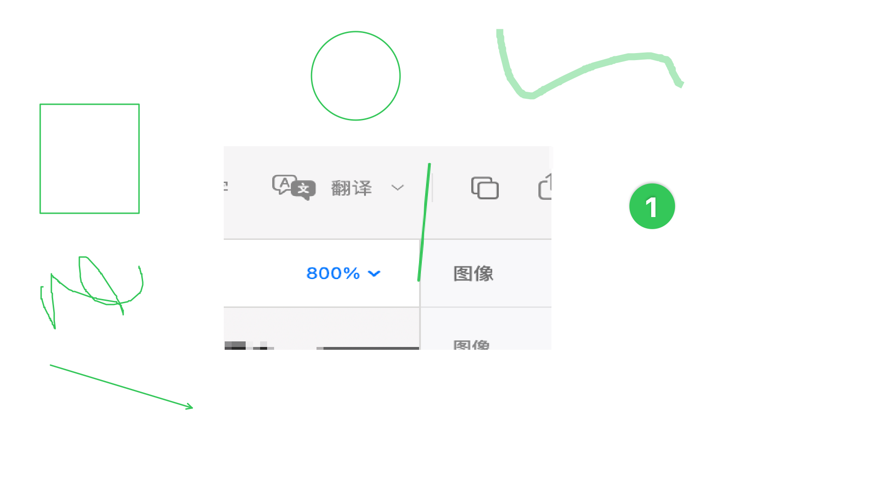

<p align="center"></p>
<h1 align="center">Hoot</h1>
<p align="center">截图、图片浏览与编辑，在 Mac 上一气呵成。</p>
<p align="center"><a href="https://hoot.xiezhaoye.site">产品主页</a> · <a href="https://github.com/xiezhaoye/Hoot/releases/latest">下载 macOS 版</a> · <a href="https://github.com/xiezhaoye/Hoot/issues">反馈问题</a> · <a href="LICENSE">MIT License</a></p>

Hoot 是一款使用 Swift、AppKit 和 SwiftUI 开发的 macOS 原生应用，集截图、图片浏览与编辑于一体。

作者希望把 Windows 上 [PicPick](https://picpick.app/) 截图与编辑的顺手体验带到 macOS，于是做了 Hoot。这是受 PicPick 启发的独立实现，并非 PicPick 的官方 macOS 版本或代码移植。



<!-- landing -->
- **截下来，直接编辑**：全局快捷键框选区域或悬停选择窗口，截完就能标注、识字、翻译或贴图。
- **从圈出重点到分享一张讲清楚的图**：矩形、箭头、画笔、序号、马赛克、裁剪一应俱全，所有对象可再次编辑。
- **本地优先**：截图历史与 OCR 都在本机完成；翻译只会发送到你自己配置的接口。



## 能做什么

- **快捷截图**：全局快捷键 `⌃⌥A`，区域选择、窗口 / 模块候选、可选透明圆角、多显示器与 Retina 支持；截图后快速复制、编辑、识字、翻译或贴图。
- **标注与编辑**：矩形、椭圆、直线、箭头、画笔、荧光笔、文字、序号、马赛克、模糊、裁剪；支持撤销与重做。
- **精确调整**：可编辑标注的颜色、线宽、填充、不透明度、圆角、阴影、尺寸、位置与排列；文字支持换行和再次编辑。
- **局部覆盖**：多次复制/粘贴形成独立可编辑区块，随时移动、缩放；固定全部或 ⌘S 保存时统一合并，⌘Z 可撤销固定。
- **图片浏览**：按分组管理本地文件夹，单图与缩略图网格，左右翻页、键盘浏览，一键送入编辑器，保留原文件。
- **本地文字识别**：使用 Apple Vision 识别中英文。翻译可使用自行配置的大模型接口，失败或未配置时回退系统本地翻译。
- **悬浮贴图**：`⌃⌥P` 钉住剪贴板图片，支持拖动、缩放和透明度。
- **文字编辑**：短文字保留宽点击区域，输入框可移动；回车换行，无自动折行，编辑中可实时改色、字号和透明度。
- **更新与恢复**：设置中检查更新、查看版本和项目链接；重启恢复所有画板与可编辑对象。
- **本地历史**：截图保存在本地，支持搜索、保留数量、保存目录与格式设置；完整取色器、吸管和最近 10 色可用。

滚动长截图、录屏和视频剪辑尚未实现。

## 下载与运行

当前提供 **macOS 15+ / Apple Silicon** 的早期预览版：

1. 从 [GitHub Releases](https://github.com/xiezhaoye/Hoot/releases/latest) 下载并解压 ZIP。
2. 将 `Hoot.app` 拖入“应用程序”。
3. 首次截图时，在“系统设置 → 隐私与安全性 → 屏幕与系统音频录制”允许 Hoot，然后重开应用。

更精确地识别其他 App 的控件，可在“设置 → 通用 → 截图”中授权辅助功能；未授权仍可使用图像矩形识别和手动框选。部分自绘区域没有可识别的模块边界。

当前安装包未经过 Apple 公证；如果系统提示无法验证开发者，可在“系统设置 → 隐私与安全性”确认应用来源后选择“仍要打开”。

OCR 在本机完成。使用大模型翻译时，识别后的文字会发送到你配置的接口；API Key 存在 macOS 钥匙串中。

## 常见问题

**Hoot 免费吗？**  
免费，MIT 协议开源。

**第一次截图没反应？**  
在“系统设置 → 隐私与安全性 → 屏幕与系统音频录制”允许 Hoot，然后重新打开应用。

**识字和翻译会上传图片吗？**  
不会。识字使用 Apple Vision，在本机完成；启用大模型翻译时，只有识别出的文字会发给你配置的接口。

## 从源码构建

需要 macOS 15+ 与提供 Swift 6 工具链的 Xcode / Command Line Tools。

```bash
swift test
SHOTPAD_IDENTITY=- ./scripts/bundle.sh
open Hoot.app
```

上面的命令使用临时签名。开发时可用 `SHOTPAD_IDENTITY` 指定自己的稳定签名证书，以保持重建后的系统录屏授权。构建脚本默认使用作者本机的开发证书。

版本号唯一来源是仓库根目录的 [`VERSION`](VERSION)（第 1 行营销版本 `X.Y.Z`，第 2 行 build 号）；构建脚本与落地页都从它读取，不要手写版本号。

## 工程结构

- `Sources/ShotPad`：AppKit / SwiftUI 界面、截图遮罩、画布、浏览和贴图。
- `Sources/ShotPadCore`：标注、渲染、浮动块、撤销、历史、OCR 与翻译逻辑。
- `Tests/ShotPadCoreTests`：核心逻辑回归测试。
- `docs/FEATURES.md`：完整功能与交互约定。
- `landing/`：产品落地页及 Cloudflare Workers 部署配置（`index.html` 里只写 `{{VERSION}}` 占位符，构建时从 `VERSION` 填入）。

应用显示名是 **Hoot**。为兼容早期版本，SwiftPM 目标 `ShotPad`、bundle ID `com.xiezhaoye.shotpad`、数据目录 `~/Library/Application Support/ShotPad/` 和钥匙串服务名 `ShotPad.LLM` 保持不变。

## 落地页部署

与 XMark 使用相同方式：Cloudflare Workers 托管静态资源，绑定自定义域名。详见 [landing/README.md](landing/README.md)。

## 作者与协议

由 [xiezhaoye](https://github.com/xiezhaoye) 开发，以 [MIT 协议](LICENSE) 开源。欢迎提 Issue 和 Pull Request。
